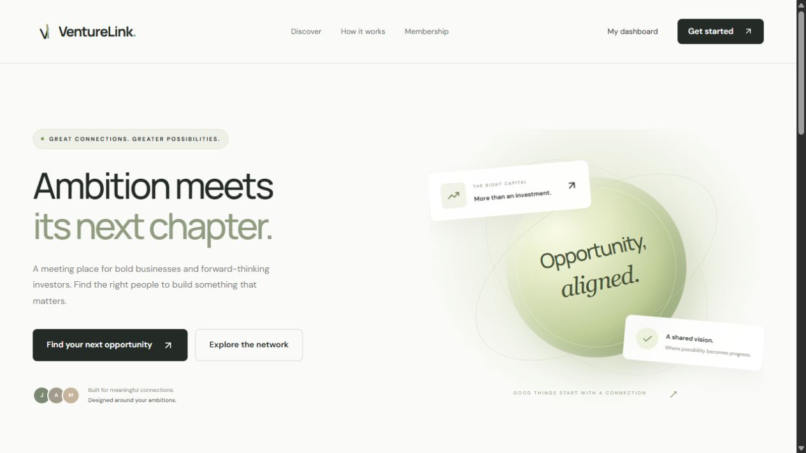

# VentureLink

### Opportunity, aligned.

A membership platform connecting ambitious businesses with aligned investors. VentureLink combines profile discovery, compatibility matching, private conversations, pitch decks, document verification, and manual administration in a cohesive, responsive experience.



**[Visit the deployed site](https://venturelink.adam-vamshikrishna.chatgpt.site)** · [Features](#features) · [Getting started](#getting-started) · [Architecture](#architecture) · [Launch checklist](#launch-checklist)

> **Status:** The application is deployed privately. Live payment collection requires Stripe configuration and a reachable webhook endpoint. A public GitHub repository does not change the website's private access policy.

## Overview

Finding capital or an investment opportunity is about more than a funding number. VentureLink helps both parties explain their goals, discover relevant profiles, and start a conversation around a shared vision.

- **Businesses** describe their vision, sector, funding requirements, location, stage, and partnership needs.
- **Investors** share investment preferences, budget, location, stage, and the businesses they want to support.
- **Administrators** review registrations and documents, approve or deactivate profiles, and monitor collected subscription revenue.

The interface uses warm neutrals, restrained green accents, generous spacing, consistent cards and forms, and responsive layouts for desktop and mobile.

## Features

| Area | Included behavior |
| --- | --- |
| Registration | Role-specific investor and business onboarding, sector, country, funding budget, stage, and open-ended goals |
| Authentication | Platform-owned ChatGPT sign-in and sign-out with user-specific account records |
| Membership | Stripe Checkout integration for a recurring $10 monthly **or** $10 yearly membership |
| Billing | Stripe Customer Portal integration for billing management and cancellation once configured |
| Discovery | Search by name or description; filter by role, sector, funding amount, country, and verified status |
| Matching | Rank opposite-party profiles and suggest up to five compatible matches |
| Connections | Send a private introduction; acceptance opens further messaging |
| Inbox | Requests, active conversations, persisted message history, and direct replies |
| Live updates | Authenticated Server-Sent Events with periodic change detection and a refresh fallback |
| Pitch decks | Upload PDFs or images and display authorized file links on profile cards and dialogs |
| Verification | Private identity or business-registration documents; manual review controls Verified badges |
| Administration | Registration list, approval, deactivation, verification, and collected-revenue totals |
| Profile reminders | Dashboard prompts to review profile details at the selected monthly or yearly interval |
| Responsive design | Shared navigation, mobile layouts, keyboard-accessible controls, and profile dialogs |

## Membership and access

The current pricing is **$10 per month or $10 per year**, according to the member's preference. There is no additional one-time registration charge.

1. Sign in and prepare an investor or business profile.
2. Save the profile and complete Stripe Checkout when payments are configured.
3. Upload a pitch deck, verification documents, or both as appropriate.
4. An administrator reviews the profile and any verification documents.
5. Approved, paid members can discover real profiles, request connections, and message accepted connections.

Payment, profile approval, and document verification are separate states. Uploading a document does not automatically verify a member. Editing a profile sends it for re-approval and clears its verification badge.

## Matching model

Matches are recomputed from current profile preferences and ranked using:

| Factor | Weight |
| --- | ---: |
| Sector alignment | 40% |
| Investment stage | 20% |
| Country | 15% |
| Proportional funding alignment | 25% |

Only approved, paid profiles from the opposite party are suggested. The dashboard displays at most five matches; fewer appear when the eligible network is smaller. Compatibility scores are heuristics, not investment recommendations or guarantees of funding.

## Messaging and privacy

- Contact email addresses are not published in Discovery or automatically shared in conversations.
- Requests include an introduction; further replies require acceptance.
- Conversation actions check participation and both members' active status.
- Messages and connection records persist in D1.
- Authenticated event streams check for changes every two seconds, reconnect after approximately 50 seconds, and use a 15-second refresh fallback.
- Members choose whether to share personal contact details in a message.

## Uploads and verification

Supported formats are **PDF, JPG, and PNG**, limited to **10 MB per upload**. The server checks MIME types and file signatures before storing files in R2.

- **Pitch decks:** Accessible to their owner, administrators, and approved, paid members when the publishing profile remains active.
- **Verification documents:** Accessible only to their owner and authorized administrators.
- **Verified badge:** Applied manually after a document exists for review. It does not endorse a business or guarantee an investment outcome.

## Pages

| Route | Purpose |
| --- | --- |
| `/` | Marketing homepage, illustrative profiles, and membership information |
| `/register` | Investor and business onboarding |
| `/dashboard` | Membership status, connection counts, top matches, and review reminders |
| `/discovery` | Search and filter the network |
| `/inbox` | Connection requests and active conversations |
| `/settings` | Profile details, billing, pitch decks, and verification documents |
| `/admin` | Administrator-only review and revenue monitoring |
| `/privacy` | Privacy, membership, and trust information |

Unknown routes return a 404. Before membership approval, profiles are clearly identified as illustrative and cannot receive real connection requests.

## Technology stack

| Layer | Technology |
| --- | --- |
| Interface | React 19, TypeScript, CSS, Lucide icons |
| Framework | Vinext with Next.js-compatible routing |
| Build | Vite and the Cloudflare Vite integration |
| Runtime | Cloudflare Workers |
| Data | Cloudflare D1 / SQLite, Drizzle ORM and migrations |
| Files | Cloudflare R2 |
| Identity | Sites-managed ChatGPT authentication |
| Payments | Stripe Checkout, Customer Portal, and signed webhooks |
| Live conversations | Server-Sent Events |
| Hosting | Sites |

## Architecture

The React interface calls server routes that validate identity, permissions, and membership before reading or changing data.

```text
Browser / React UI
        |
        +-- /api/platform ------ identity + access checks
        |                              |
        |                              +-- D1: profiles, connections, messages,
        |                              |       uploads, payments, billing
        |                              +-- R2: pitch decks + private documents
        |                              +-- Stripe: checkout + billing portal
        |
        +-- /api/events -------- authenticated conversation-change stream
        |
Stripe -- /api/stripe/webhook -- signature checks + billing reconciliation
```

### Source layout

```text
app/
  platform.tsx                  Shared application views and interactions
  globals.css                   Responsive visual system
  chatgpt-auth.ts                Sign-in and identity helpers
  [section]/page.tsx            Dashboard, Discovery, Inbox, and account pages
  api/platform/route.ts         Profiles, uploads, payments, messaging, admin API
  api/events/route.ts           Authenticated live-update stream
  api/stripe/webhook/route.ts   Signed Stripe webhook processing
components/                     Shared starter UI components
db/                             D1 connection and schema declarations
drizzle/                        SQL migrations and schema metadata
docs/images/                    README project screenshot
scripts/                        Runtime, build, and local-preview tooling
tests/integration.py            Local onboarding and access-control checks
worker/index.ts                 Production Worker entry point
.openai/hosting.json             Sites identity and D1/R2 declarations
```

## Getting started

### Prerequisites

- Node.js **22.13.0 or newer**
- npm and Git
- Python 3 for the included local integration checks

### Install and run

```bash
git clone https://github.com/vams2krish/VentureLink.git
cd VentureLink
npm ci
npm run dev
```

The portable development preview normally serves at **http://127.0.0.1:5173**. Use the address printed by the server if a different port is selected.

Local sign-in uses a development-only identity (`seedy@sites.test`). The mock authentication shim is excluded from production builds. Hosted authentication depends on Sites; this repository is not a standalone password-authentication service.

### Initialize local storage

The hosting manifest declares the `DB` D1 binding and `BUCKET` R2 binding. Build once to generate the local Worker configuration:

```bash
npm run build
```

Apply each migration once, in order:

```bash
node --import ./scripts/sites-env.mjs ./node_modules/wrangler/bin/wrangler.js d1 execute DB --local --config dist/server/wrangler.json --persist-to .wrangler/state --file drizzle/0000_flat_lady_mastermind.sql
node --import ./scripts/sites-env.mjs ./node_modules/wrangler/bin/wrangler.js d1 execute DB --local --config dist/server/wrangler.json --persist-to .wrangler/state --file drizzle/0001_equal_warbound.sql
```

Local and production databases are separate. Do not replay applied migrations. After schema changes, run `npm run db:generate`, inspect the generated SQL, and apply only new migrations.

### Runtime configuration

The `.env.example` file lists required configuration names. Configure actual values as hosted runtime secrets or appropriate ignored local runtime configuration.

| Variable | Purpose |
| --- | --- |
| `STRIPE_SECRET_KEY` | Server-side Stripe API access |
| `STRIPE_WEBHOOK_SECRET` | Incoming webhook signature validation |
| `ADMIN_EMAILS` | Comma-separated administrator email allowlist |

Never put actual secrets into source files, the hosting manifest, or browser code. Local environment files, runtime state, databases, and build output are ignored by Git.

## Stripe setup

1. Configure the Stripe secret key and webhook signing secret for the runtime.
2. Enable and configure the Customer Portal, including cancellation.
3. Register a publicly reachable snapshot-event endpoint at `/api/stripe/webhook`.
4. Subscribe to:

```text
checkout.session.completed
invoice.paid
invoice.payment_failed
customer.subscription.updated
customer.subscription.deleted
customer.subscription.paused
customer.subscription.resumed
```

5. Test Checkout, renewal, cancellation, failed payments, and portal access in Stripe test mode before activating live payments.

Checkout returns are verified server-side. Webhooks use HMAC signature validation and timestamp tolerance. Invoice identifiers deduplicate recorded payments so an initial checkout and its invoice do not count as two payments. Subscription status controls paid access; admin approval remains independent.

Admin revenue reports recorded collected payments in USD before Stripe fees. It is not a net-revenue report, refund ledger, or monthly recurring revenue calculation.

References: [Stripe webhooks](https://docs.stripe.com/webhooks) and [subscription events](https://docs.stripe.com/billing/subscriptions/webhooks).

## Validation

```bash
npx tsc --noEmit
npm run build
```

With the development server running and local migrations applied:

```bash
python tests/integration.py
```

The integration script creates a synthetic local profile and verification document. Use only a disposable local development database.

The initial implementation was reviewed on desktop and mobile. **43 local checks** passed across onboarding and uploads, connections, accepted replies and event streams, administration and privacy, webhook signatures, and production page responses. Some checks used temporary local harnesses rather than the committed integration script. Live Stripe transactions have not been exercised because account credentials are still required.

## Deployment

The checkout retains the original Sites identity in `.openai/hosting.json`. Publishing to that project requires the owner's Sites access. For an independent deployment, create a separate Sites project and use its returned identity instead of reusing the original ID.

Production publication packages the Worker and assets, synchronizes the exact source state, applies migrations, and deploys a saved version through Sites. Configure secrets through the hosting platform. Never commit deployment credentials.

The existing deployment is **owner-private**. Publishing this repository does not make the website public, expose its database, or give repository visitors administrator access.

## Launch checklist

- [ ] Connect the intended Stripe account and configure runtime secrets.
- [ ] Configure the Customer Portal and webhook endpoint.
- [ ] Complete end-to-end Stripe test-mode and renewal/cancellation testing.
- [ ] Confirm the $10 monthly / $10 yearly pricing.
- [ ] Explicitly configure the website's audience for customer enrollment.
- [ ] Add the operator's business identity, support contact, and terms.
- [ ] Define verification procedures, document retention, and deletion handling.
- [ ] Review abuse prevention, monitoring, backup, and recovery for expected traffic.

## Current boundaries

- Profile-review reminders appear inside the dashboard; reminder emails are not implemented.
- Bookmarks last for the current page session.
- Verification is manual, not an external identity-verification service.
- The homepage uses illustrative profiles; no demo members are seeded into production.
- The application does not transfer investment funds between members.
- Live payment collection stays disabled until Stripe is configured.

## Licensing

No project-wide open-source license has been selected. Public source availability does not itself grant an open-source license. Included third-party components retain their distributed notices, including those under `vendor/` and `scripts/vite/`.
